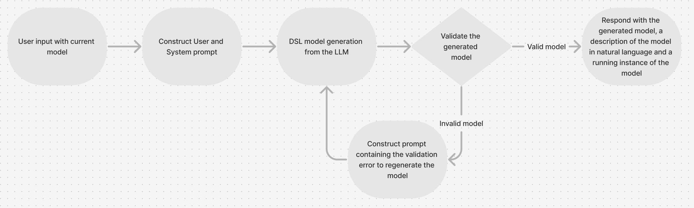

# LLM to DSL: SmAuto and dFlow models from natural language

Describe a smart-home automation or a virtual-assistant dialogue in plain English and get back a valid model in the corresponding domain-specific language: **SmAuto**, whose models compile to executable Python automations for smart environments, or **dFlow**, whose models compile to Rasa dialogue assistants. Generation runs on GPT-4o through LangChain. A structured system prompt teaches the LLM the DSL, a validator-in-the-loop stage feeds syntax errors back to the LLM until the model parses, and an optional question-and-answer stage asks the user for whatever the description left out before anything is generated.

This is the code of my diploma thesis at the School of Electrical and Computer Engineering, Aristotle University of Thessaloniki (July 2025). The thesis evaluates it on 44 generated models across four experiments; the models (41 of the 44 survive) and the results are in [`experiments/`](experiments/README.md).



## How it works

**The system prompt is a course on the DSL.** The LLM has not seen SmAuto or dFlow in training, so the prompt has to make it an "expert" in the language. Each prompt module is organised like technical documentation for a reader with zero prior knowledge: a role statement, a description of the language and its domain, then one section per language concept (for SmAuto: brokers, entities, automations, the system clock, metadata and monitoring) with the syntax, the properties, worked examples and the rules that separate valid from invalid models. `smauto_prompts.py` and `dflow_prompts.py` hold about 11,000 words of this material. The dFlow prompt additionally carries example description/model pairs from `dflow_examples/llm_4_dflow/` as few-shot examples.

**Validation closes the loop.** Every generated model is posted to the DSL's own validator (the REST API of the SmAuto or dFlow project, running locally). If the model does not parse, the validator's error (line, column, expected tokens) is sent back to the LLM together with a fixed correction prompt that explains how to read the message and lists the mistakes that were found to recur. The loop runs at most five times and stops early when the same error comes back twice in a row, since a further attempt is unlikely to help. Every attempt is kept on disk. One pass looks like this (robustness run 8, `experiments/smauto/exp3_robustness/run08_20250610-000046/`): the validator rejected `bedroom_ac.temperature: 23` for an attribute declared as `float`, the error went back to the LLM, and the second attempt wrote `23.0` and passed.

**The question-and-answer stage fills the gaps.** Most real descriptions are incomplete. In the "conversation with feedback" mode the LLM first acts as an analyst: it summarises the goal, maps the description onto the components of the DSL (for SmAuto: metadata, brokers, entities, automations, monitoring; for dFlow: entities, triggers, dialogues, services, access control), lists what is missing against a checklist derived from the language's metamodel, and produces the questions to ask. It then asks them one at a time. The user can answer, skip (the system states a reasonable assumption and asks for confirmation) or add details. When the checklist is complete the assistant replies "Q&A process complete." and the model is generated from the original description plus the whole exchange, then validated as above. A full transcript of such a session is in `experiments/dflow/exp4_description_quality/good/qna/session_log.txt`.

**The output is a model file.** SmAuto runs write `logs/<timestamp>/user_utterance.txt`, `smauto_model.auto` and one `regenerated_smauto_model_N.auto` per correction attempt. dFlow runs write `logs_dflow/<timestamp>_dflow_model.dflow`, `<timestamp>_regenerated_dflow_model_N.dflow` and, after a Q&A session, `<timestamp>_dflow_model_after_qa.dflow`. The last file of a run is the model to use.

## What it produces

Four models from the thesis experiments; the full files are under `experiments/`.

### SmAuto: a poor description, without and with the Q&A stage

Experiment 4 gave the system a deliberately poor description of the smart-home scenario: a very general request that names the rooms and the devices but not the brokers, the thresholds or the schedules. Without the Q&A stage the system still produced a complete, valid template (`experiments/smauto/exp4_description_quality/poor/plain.auto`, 139 lines), but it had to invent everything the description did not say: an author "Jane Doe", two MQTT brokers at `192.168.1.100` and `192.168.1.101` with `main_user`/`main_pass` credentials, and threshold values of its own choosing:

```smauto
Broker<MQTT> main_broker
    host: "192.168.1.100"
    port: 1883
    ssl: false
    auth:
        username: "main_user"
        password: "main_pass"
end

Automation turn_on_bedroom_lamp
    condition:
        bedroom_temperature_sensor.temperature < 16
    enabled: true
    continuous: false
    actions:
        - bedroom_lamp.power: true
end
```

With the Q&A stage, the analysis of the same description produced 26 questions, and the model generated afterwards (`poor/qna.auto`, 125 lines) has the real broker (`mqtt.smarthome.local`, port 8883, SSL, the `casa_nova` account), the Redis monitoring broker with its namespace and topics, the requested model name and author, sensors with value generators, and the thresholds the user actually wanted:

```smauto
Automation bedroom_lamp_on_cold
    condition:
        bedroom_temp_sensor.temperature < 18
    enabled: true
    continuous: false
    actions:
        - bedroom_lamp.power: true
end
```

Scores on the five criteria (see below): 4 / 2 / 3 / 5 / 5 without the questions, 4 / 5 / 4 / 5 / 5 with them. Semantic fidelity went from 2 to 5, the level of the best model in the whole evaluation.

### SmAuto: the best model

That best model (`experiments/smauto/exp4_description_quality/good/qna.auto`, 156 lines, 5 on every criterion) came from the detailed description with the Q&A stage. The part that is hardest to get right is the pair of purifier automations that must start each other and run at different check frequencies; the model renders it with `starts:` and `freq:` exactly as the language intends:

```smauto
Automation living_room_hot_humid
    condition:
        ((living_room_temp_humidity.temperature > 25) AND 
        (living_room_temp_humidity.humidity > 60)) AND 
        (living_room_lamp.power is false)
    enabled: true
    continuous: false
    actions:
        - living_room_air_purifier.power: true
        - living_room_air_purifier.mode: "auto"
    starts:
        - living_room_normal_levels
    freq: 90
end

Automation living_room_normal_levels
    condition:
        (living_room_temp_humidity.temperature < 24) AND 
        (living_room_temp_humidity.humidity < 50)
    enabled: false
    continuous: false
    actions:
        - living_room_air_purifier.power: false
    starts:
        - living_room_hot_humid
    freq: 120
end
```

### dFlow: the thesis's worked example

The simple model of experiment 1 (`experiments/dflow/exp1_complexity/simple/regenerated_1.dflow`, 60 lines) is the one the thesis scores step by step. The description asks for an assistant with two functions: the coordinates of a city, and the EV charging stations around a location, each served by a REST call. The model has the right services, intents, forms and dialogues, and two errors that the correction loop could not remove:

```dflow
            ActionGroup retrieve_stations_action
                charging_stations_svc(query=[latitude=ChargingStationsForm.latitude, 
                                             longitude=ChargingStationsForm.longitude, 
                                             radius=ChargingStationsForm.radius],
                                      header=[Authorization='Q5eJZ8sSLEX6XNmOHyMlWagI'],)
                Speak('Here are the nearby charging stations:')
                // Assuming a function parse_charging_stations_response to format the result
                Speak(parse_charging_stations_response())
            end
```

`parse_charging_stations_response()` does not exist in dFlow: the LLM fell back to a general-purpose-language habit. Further down, `[response_filter=lat]` is an invented syntax for extracting a field from the response. The validator reported the first error twice in a row and the loop stopped:

```
{"detail":"Validation error: ...dflow:44:55: Expected '.' or '[' or STRING or 'USER:' or 'SYSTEM:' or ID or ')' => 's_response*())       '"}
The same validation error appeared two consecutive times.
Unable to fix the error. Terminating the regeneration process.
```

The thesis scores it 3 / 4 / 3 / 3 / 5: the intents and dialogues match the description, the data returned by the services is never used in the answers, and the invented function counts as an unjustified addition. It is still a usable starting point, which is the thesis's general verdict on dFlow output.

### dFlow: a complete model

One of the ten robustness runs (`experiments/dflow/exp3_robustness/run02.dflow`, 124 lines) shows the full scenario: three intents, five services, three dialogues with forms, and role-based access control that limits what free users get to see:

```dflow
            ActionGroup charging_action
                RESTCall(get_charging_stations_svc(query=[latitude=charging_form.latitude, longitude=charging_form.longitude, radius=charging_form.radius], header=[Authorization='Q5eJZ8sSLEX6XNmOHyMlWagI']))[tags.name]
                Speak('Polis Park – operated by ' get_charging_stations_svc.tags.operator ' at latitude ' get_charging_stations_svc.latitude ', longitude ' get_charging_stations_svc.longitude)[roles=paid_user]
                Speak('This feature is available only to paid users.')[roles=free_user]
            end
```

```dflow
access_controls
    Roles
        paid_user,
        free_user
        
        default: 
            free_user
    end

    Path
        "/home/Desktop/users.txt"
    end

    Authentication
        method: user_id        
    end
end
```

The ten runs score a mean of 3.5 on syntactic validity and 3.8 on semantic fidelity, so a model like this one typically needs a developer to fix one or two lines before it compiles.

## Results

The thesis has no automatic way to judge whether a model matches a description (none exists in the literature for this task), so every final model was scored by the author on five criteria, 1 to 5:

- **Syntactic Validity**: does the model parse under the DSL grammar, after the correction loop?
- **Semantic Fidelity**: does it capture what the description asked for, completely and correctly?
- **Operational Logic Soundness**: do the conditions, actions, flows and service calls work together as the scenario requires?
- **Unjustified Additions**: 5 means nothing was added that the description does not support.
- **Model Economy and Simplicity**: no needless repetition or complexity.

Four experiments were run for each DSL: complexity of the description (simple, complex, and "special", which needs an optional language feature); incremental development over three turns; robustness (the same description ten times); and description quality (good, medium, poor, each with and without the Q&A stage). That is 22 final models per DSL, 44 in total. Mean and variance over the 22:

| Criterion | SmAuto | dFlow |
|---|---|---|
| Syntactic Validity | 4.55 (0.26) | 3.68 (0.51) |
| Semantic Fidelity | 4.77 (0.18) | 3.73 (0.49) |
| Operational Logic Soundness | 3.91 (0.18) | 2.27 (0.37) |
| Unjustified Additions | 5 (0) | 4.64 (0.34) |
| Model Economy and Simplicity | 5 (0) | 4.77 (0.18) |

Three findings, in plain words:

1. **The complexity of the DSL drives quality, not the complexity of the description.** Simple, complex and special descriptions scored alike within each language, while SmAuto (a small language with a narrow domain) beat dFlow (dialogue logic, external services, stricter syntax) on every criterion.
2. **Errors repeat rather than vary.** Under the same input the system makes the same mistakes: the parentheses error in SmAuto in 7 of 10 runs, the response-filter and unused-response-data errors in dFlow. That is a property that makes the system improvable by targeted prompt changes, and it is why the variances above are small.
3. **The Q&A stage lifts weak descriptions.** On SmAuto, a very general request went from 2/5 to 5/5 on semantic fidelity after the questions (26 of them), reaching the level of a detailed description. On dFlow the gain was smaller (1 to 3 on the poor description, 2 to 4 on the medium one) because the system did not always use the information it had collected.

The per-experiment tables and every scored model are in [`experiments/`](experiments/README.md).

## Running it

You need Python 3.12, an OpenAI API key, and the validator of the DSL you want to generate, which both projects ship as a Docker image with an API-key-protected REST API:

- SmAuto: [`robotics-4-all/smauto`](https://github.com/robotics-4-all/smauto). `make build` then `make up API_KEY=API_KEY` starts the API on port 8080.
- dFlow: [`robotics-4-all/dFlow`](https://github.com/robotics-4-all/dFlow). The repository includes a Dockerfile and a docker-compose file; the API key you configure there goes into `.env` below.

Both clients in this repository (`smauto_api.py`, `dflow_api.py`) call `http://localhost:8080/validate`, so run the validator for the DSL you are generating, or change the port in the container and the URL in the client.

```bash
git clone https://github.com/johnkouk469/llm-to-dsl-thesis.git
cd llm-to-dsl-thesis
python -m venv venv
source venv/bin/activate        # Windows: venv\Scripts\activate
pip install -r requirements.txt
```

Create a `.env` file in the repository root:

```env
OPENAI_API_KEY="sk-proj-..."
SMAUTO_API_KEY="API_KEY"        # the key you started the SmAuto API with
DFLOW_API_KEY="123"             # the key configured in the dFlow API
```

Then start the assistant for the DSL you want:

```bash
python llm_to_smauto.py
python llm_to_dflow.py
```

Each script offers a menu: option 1 generates a model straight from your description (and lets you keep refining it in further messages, since the conversation history is kept); option 2 is the analysis and question-and-answer flow described above. Type `Exit` at any prompt to leave. Each run costs a handful of GPT-4o calls; the system prompt alone is several thousand tokens.

To check a model file against a running validator without the LLM, run the client directly, for example `python smauto_api.py experiments/smauto/exp1_complexity/simple/model.auto`.

The thesis results were produced with the pipeline code frozen at tag `v1.0-thesis`; later commits may refactor it.

## Repository layout

| Path | What it is |
|---|---|
| `llm_to_smauto.py` | The SmAuto pipeline: generation, validation loop, analysis and Q&A, interactive menu. |
| `llm_to_dflow.py` | The same pipeline for dFlow. |
| `smauto_prompts.py`, `dflow_prompts.py` | The system prompts, the correction prompt, the analysis and Q&A prompts, and the prompt assembly. |
| `smauto_api.py`, `dflow_api.py` | Thin clients for the validators' `/validate` (and generation) endpoints; both can be run directly to validate model files. |
| `experiments/` | The evaluated models (41 of the 44) with their descriptions, correction attempts and logs, indexed by experiment (see its README). |
| `dflow_examples/` | dFlow example models; `dflow_examples/llm_4_dflow/` holds the description/model pairs the dFlow prompt uses as few-shot examples. |
| `docs/` | The pipeline diagram. |
| `logs/`, `logs_dflow/` | Created at run time; git-ignored. |

## The thesis

*Development of a system for generating DSL models from textual descriptions using LLMs* (in Greek), diploma thesis, School of Electrical and Computer Engineering, Aristotle University of Thessaloniki, July 2025. Supervised by Prof. Andreas Symeonidis with PhD candidate Nikolaos Malamas. Record in the AUTh institutional repository: [ikee.lib.auth.gr/record/365271](https://ikee.lib.auth.gr/record/365271).

Chapter 5 describes the pipeline and the prompt design, chapter 6 the evaluation method, the four experiments and the results, chapters 7 and 8 the conclusions and future work.

## Limitations and future work

- Scoring was manual and by one person. A reproducible evaluation method for "does this model match this description" does not exist yet, and building one (possibly LLM-assisted) is the first item of future work.
- The system was evaluated with one LLM (GPT-4o) and one prompt design per DSL. Comparing models and prompt variants was out of scope.
- Fine-tuning was not attempted: there are not enough complex, real-world models of either DSL to build a training set from.
- Human review remains necessary. The models are good starting points and often complete, but the dFlow ones in particular need a developer to fix data handling before use.
- The two pipelines are separate scripts that duplicate the same loop. Merging them into one pipeline parameterised by DSL, with a command-line interface and tests, is the next engineering step.
- The thesis proposes turning the tool from a generator into a modelling assistant that explains what it produced and what still needs a human decision.

## Acknowledgments

The thesis was supervised by members of the Intelligent Systems and Software Engineering Labgroup (ISSEL) at AUTh, which develops both target languages. [SmAuto](https://github.com/robotics-4-all/smauto) and [dFlow](https://github.com/robotics-4-all/dFlow) are their projects; the example models under `dflow_examples/` come from the dFlow repository and remain under its terms.

## License

The code in this repository is released under the MIT License (see `LICENSE`).
